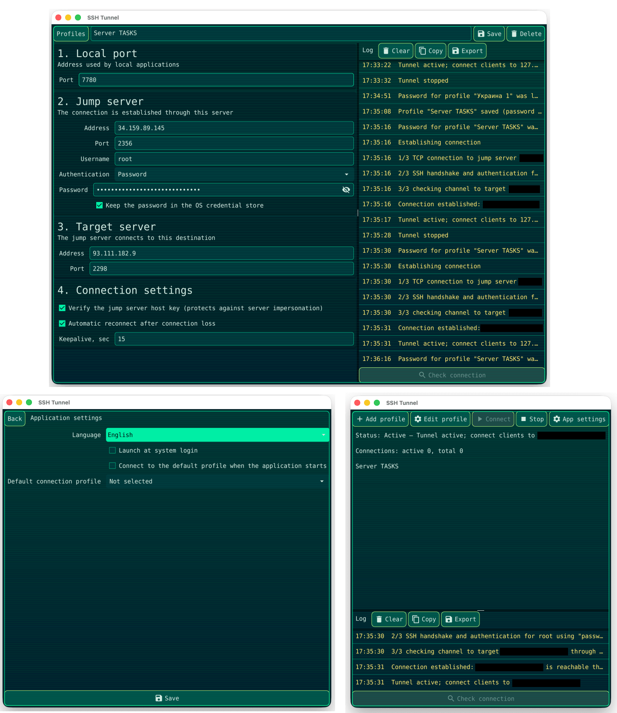

# SSH Tunnel



Настільна програма для створення TCP-тунелю через проміжний SSH-сервер (jump-сервер). Jump-сервер підключається до `target_host:target_port`, а локальні програми — до `127.0.0.1:<локальний порт>`.

Програму написано мовою Go з використанням Fyne. Підтримуються macOS (Apple Silicon та Intel), Windows x64 і Linux x64.

## Можливості

- Автентифікація за паролем, приватним ключем або через `ssh-agent`.
- Перевірка TCP-доступності jump-сервера, SSH-автентифікації, ключа вузла, доступності цілі через jump-сервер і локального порту.
- Перевірка ключа jump-сервера за допомогою файлу програми та `~/.ssh/known_hosts`. Новий ключ потребує підтвердження; збережений ключ, який змінився, відхиляється.
- Keepalive, виявлення втрати з'єднання та автоматичне повторне підключення за бажанням.
- Профілі з'єднань. Паролі не зберігаються у файлах профілів; за бажанням вони зберігаються у сховищі облікових даних операційної системи.
- Журнал у вікні зі станом, лічильниками з'єднань, копіюванням, експортом і очищенням.
- Англійська й українська мови інтерфейсу; під час першого запуску вибрано англійську.
- Необов'язковий запуск під час входу в систему й автоматичне підключення до вибраного профілю за замовчуванням.
- Під час запуску вибирається наявний профіль за замовчуванням; якщо його немає — перший профіль за алфавітом. Сам вибір не запускає з'єднання.

## Збірка та запуск

Потрібна версія Go 1.26 або новіша й компілятор C для поточної платформи (Fyne використовує CGO).

```bash
make all        # статичний аналіз, тести та збірка для поточної ОС
make run        # запуск із вихідного коду
make test       # тести з детектором гонок
make tools      # встановлення інструментів пакування Fyne
make mac        # універсальний виконуваний файл macOS і пакет програми
make mac-dmg    # образ macOS з інструкцією першого запуску
make windows    # виконуваний файл для Windows x64
make linux      # пакет Linux x64 за допомогою Docker і fyne-cross
make icon       # повторне створення assets/icon.png
```

Для macOS команда `make mac` потребує Xcode Command Line Tools. Пакет програми не підписаний. Образ містить файл `macos/FIRST-LAUNCH.txt` з інструкціями відкриття програми через стандартне попередження безпеки macOS.

Для кросзбірки Windows на macOS потрібен `mingw-w64`. Для кросзбірки Linux потрібні Docker і `fyne-cross`. На Ubuntu можна виконати `go build ./cmd/sshtunnel`, попередньо встановивши `libgl1-mesa-dev xorg-dev libxkbcommon-dev`.

## Використання

1. Створіть профіль і вкажіть його назву та локальний порт для прослуховування.
2. Уведіть адресу й порт jump-сервера, ім'я користувача та спосіб автентифікації.
3. Уведіть адресу й порт цільового сервера — він має бути доступний із jump-сервера.
4. Налаштуйте перевірку ключа вузла, автоматичне повторне підключення й keepalive.
5. Збережіть профіль. Натисніть **Check connection**, щоб перевірити маршрут без запуску тунелю, а потім **Connect**, щоб його запустити.
6. Підключайте локальні програми до `127.0.0.1:<локальний порт>`. Кнопка **Stop** закриває слухач і активні з'єднання тунелю.
7. У налаштуваннях програми виберіть англійську або українську мову, за бажанням увімкніть запуск під час входу й виберіть профіль за замовчуванням.
8. Окремо ввімкніть автоматичне з'єднання, якщо вибраний профіль має підключатися під час запуску програми. Для цього параметра потрібно вибрати профіль за замовчуванням.

Слухач прив'язується до `127.0.0.1` і недоступний з локальної мережі. Якщо ввімкнено автоматичне повторне підключення, локальний слухач залишається відкритим, поки програма відновлює SSH-з'єднання.

### Автентифікація й ключі вузлів

- **Password** використовує пароль через SSH password або keyboard-interactive автентифікацію.
- **Private key** читає вибраний файл ключа; для зашифрованого ключа також потрібна парольна фраза.
- **ssh-agent** використовує ключі, доступні в запущеному агенті.
- Якщо перевірку ключа вузла ввімкнено, відомі ключі читаються з файлу `known_hosts` програми та, якщо він існує, з `~/.ssh/known_hosts`. Новий ключ додається до файлу програми лише після підтвердження. Файл користувача `~/.ssh/known_hosts` не змінюється.
- Вимкнення перевірки ключа вузла дозволяє підміну сервера й не рекомендується.
- Паролі та парольні фрази приватних ключів не записуються у файли профілів. Якщо збереження пароля ввімкнено, він записується у сховище облікових даних операційної системи.

### Журнал

У головному вікні відображається журнал вибраного профілю. **Copy** копіює журнал у буфер обміну, **Export** зберігає його як текстовий файл, а **Clear** очищає записи в пам'яті. Під час роботи зберігаються до 1 000 останніх рядків журналу.

## Розташування даних

Програма використовує системний каталог конфігурації користувача й зберігає файли в підкаталозі `sshtunnel`:

- `profiles.json` — профілі з'єднань і несекретні параметри з'єднання.
- `settings.json` — мова інтерфейсу, запуск під час входу та параметри профілю за замовчуванням.
- `known_hosts` — ключі jump-серверів, які підтвердив користувач.

Збережені паролі зберігаються окремо у сховищі облікових даних операційної системи. Файли приватних ключів залишаються за початковими шляхами. Файл користувача `~/.ssh/known_hosts` може читатися для перевірки, але не змінюється.

## Структура проєкту

```text
cmd/sshtunnel/        точка входу програми
internal/tunnel/      SSH-тунель і життєвий цикл з'єднання
internal/config/      профілі, налаштування та доступ до сховища облікових даних
internal/i18n/        англійські й українські переклади
internal/startup/     інтеграція автозапуску для користувача
internal/ui/          інтерфейс Fyne
tools/genicon/        генератор піктограми
macos/                інструкція першого запуску, включена до DMG
```
